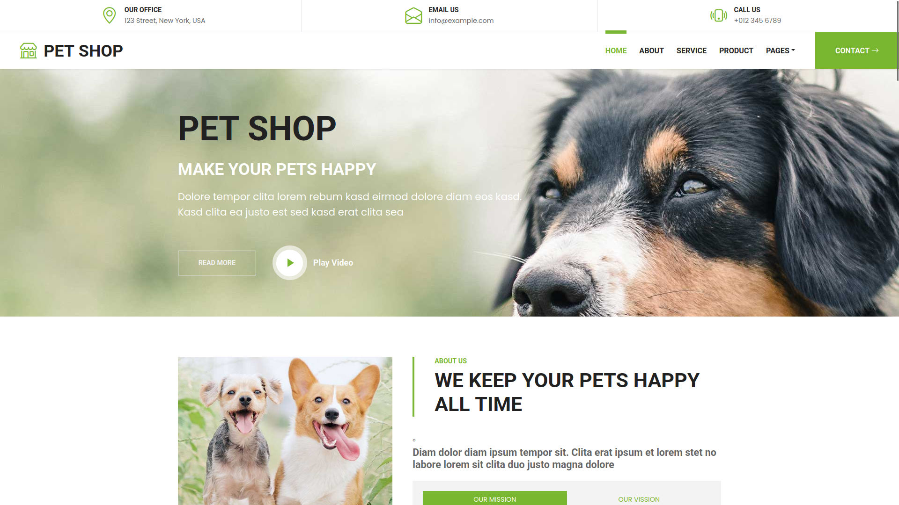

# 🐾 Pet Shop — Online Store

<p align="center">
  
  
  
  
</p>

<p align="center">
  <b>A pet shop web application built with Symfony.</b><br>
  <i>Learning project focused on web development and e-commerce functionality.</i>
</p>

---

## 📖 About the Project

**Pet Shop** is a web application developed with Symfony as a learning project focused on building an online store from scratch.

The project aims to explore the development of a complete e-commerce application, combining backend functionality with a responsive frontend interface.

The website features a modern pet shop design where users can browse products, manage their shopping cart and interact with the store.

### 🎯 Project Goals

- Learn how to develop web applications using Symfony.
- Understand the MVC architecture.
- Work with databases and dynamic content.
- Implement user authentication and management.
- Develop CRUD operations.
- Build the foundations of an e-commerce platform.

## 🖥️ Screenshots

### Homepage



### Products & Special Offers


---

## ✨ Features

- 🛍️ **Dynamic Product Catalog** — Display and browse available products.
- 🛒 **Shopping Cart** — Add and manage products before purchasing.
- 📦 **Product Management** — Create, read, update and delete products (CRUD).
- 🏷️ **Categories** — Organize products into different categories.
- 🔐 **User Authentication** — Registration and login functionality.
- ⚙️ **Administration Panel** — Manage store content and products.
- 📱 **Responsive Design** — Interface built with Bootstrap.

## 🛠️ Technologies

| Technology | Purpose |
|---|---|
| PHP | Backend programming language |
| Symfony 6.4 | Backend framework |
| Twig | Template rendering |
| Bootstrap | Frontend framework |
| HTML5 | Page structure |
| CSS3 | Styling |
| JavaScript | Client-side functionality |
| MySQL | Database management |
| Composer | PHP dependency management |

## 📂 Project Structure

```text
tienda-simfony/
│
├── bin/                # Symfony console
├── config/             # Application configuration
├── public/             # Public assets and entry point
├── src/                # Application source code
├── templates/          # Twig templates
├── var/                # Cache and logs
├── vendor/             # Composer dependencies
│
├── .env                # Environment configuration
├── composer.json       # PHP dependencies
├── composer.lock       # Locked dependencies
└── README.md
```

## 🚀 Installation & Setup

Follow these steps to run the project locally.

### 1. Clone the repository

```bash
git clone https://github.com/albertomartii/tienda-simfony.git
```

### 2. Navigate to the project directory

```bash
cd tienda-simfony
```

### 3. Install dependencies

```bash
composer install
```

### 4. Start the Symfony development server

```bash
symfony server:start
```

Open your browser and navigate to:

```text
http://localhost:8000
```

> **Note:** Make sure PHP, Composer and Symfony CLI are installed on your system. If using MySQL, configure the database connection in the `.env` file before running the application.

## 🌱 Learning Journey

This project is part of my journey into backend and full-stack web development.

Through its development, I am exploring:

- Symfony controllers, routes and services.
- Twig templates and reusable layouts.
- Database integration and data management.
- User authentication and authorization.
- CRUD operations.
- E-commerce application structure.

## 👨‍💻 Author

**Alberto Martí Llorens**

- GitHub: [@albertomartii](https://github.com/albertomartii)
- Portfolio: [albertomartii.github.io](https://albertomartii.github.io/)

---

# 🇪🇸 Versión en español

## 📖 Sobre el proyecto

**Pet Shop** es una aplicación web desarrollada con Symfony como proyecto de aprendizaje, centrado en la creación de una tienda online desde cero.

El objetivo es explorar el desarrollo de una aplicación e-commerce, combinando funcionalidades de backend con una interfaz frontend responsive.

La página presenta el diseño de una tienda de mascotas donde los usuarios pueden consultar productos, gestionar su carrito e interactuar con la tienda.

### 🎯 Objetivos

- Aprender a desarrollar aplicaciones web con Symfony.
- Comprender la arquitectura MVC.
- Trabajar con bases de datos y contenido dinámico.
- Implementar autenticación y gestión de usuarios.
- Desarrollar operaciones CRUD.
- Construir la estructura de una plataforma e-commerce.

## ✨ Funcionalidades

- 🛍️ **Catálogo dinámico** — Visualización y consulta de productos.
- 🛒 **Carrito de compra** — Añadir y gestionar productos.
- 📦 **Gestión de productos** — Crear, consultar, modificar y eliminar productos (CRUD).
- 🏷️ **Categorías** — Organización de productos.
- 🔐 **Autenticación** — Registro e inicio de sesión.
- ⚙️ **Panel de administración** — Gestión del contenido y los productos.
- 📱 **Diseño responsive** — Interfaz desarrollada con Bootstrap.

## 🛠️ Tecnologías utilizadas

- PHP
- Symfony 6.4
- Twig
- Bootstrap
- HTML5
- CSS3
- JavaScript
- MySQL
- Composer

## 🚀 Instalación

### 1. Clonar el repositorio

```bash
git clone https://github.com/albertomartii/tienda-simfony.git
```

### 2. Entrar en el directorio

```bash
cd tienda-simfony
```

### 3. Instalar dependencias

```bash
composer install
```

### 4. Iniciar el servidor

```bash
symfony server:start
```

Acceder desde el navegador:

```text
http://localhost:8000
```

> **Nota:** Es necesario tener PHP, Composer y Symfony CLI instalados. Si se utiliza MySQL, hay que configurar previamente la conexión a la base de datos en el archivo `.env`.

## 🌱 Aprendizaje

Este proyecto forma parte de mi aprendizaje en desarrollo web backend y full-stack.

Durante su desarrollo estoy trabajando con:

- Controladores, rutas y servicios de Symfony.
- Plantillas Twig y layouts reutilizables.
- Integración y gestión de bases de datos.
- Autenticación y autorización de usuarios.
- Operaciones CRUD.
- Estructura de aplicaciones e-commerce.

## 👨‍💻 Autor

**Alberto Martí Llorens**

- GitHub: [@albertomartii](https://github.com/albertomartii)
- Portfolio: [albertomartii.github.io](https://albertomartii.github.io/)

---

<p align="center">
  <b>🐾 Built with Symfony</b>
</p>
